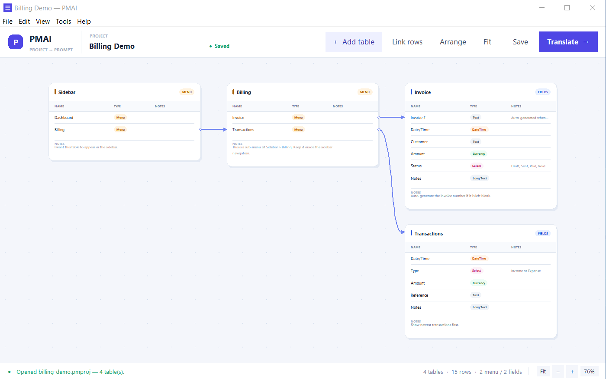

# PMAI — Project → Prompt

**PMAI is a free, offline Windows desktop app for sketching an application's
structure and turning that sketch into a precise Markdown brief for an AI coding
assistant.**

Draw menu tables, database fields, and pages of reusable UI components, connect
them with arrows, add notes, then press **Translate**. PMAI produces a
structured build specification you can paste into any AI coding tool.



## What is PMAI for?

Most AI coding prompts start as a blank chat box. Important decisions — which
screens exist, what fields an invoice has, which button opens which page — are
lost or improvised.

PMAI makes those decisions visual and explicit. You build a small diagram of the
app first, then export it as a deterministic brief. The result is a prompt that
is easier to review, easier to change, and much harder for an AI to misread.

PMAI is useful for:

- Planning a new app before asking an AI to scaffold it.
- Turning a client conversation into a concrete UI/data model.
- Keeping a project's navigation, fields, and pages in one readable file.
- Producing repeatable build briefs without writing a long prompt by hand.

Everything runs locally. There are no accounts, no server, no telemetry, and no
runtime Python packages.

## What's new in 1.1

- **New Page table kind** for screens built from reusable UI building blocks.
- **New component types:** `Button`, `TextBox`, `Text Area`, `Table`, `Tabs`,
  and heading levels `H1`–`H6`.
- **New data field types:** `Enum` and `DropDown`.
- Page tables appear on the canvas, in the status bar, and in the AI brief.
- Project format version 2; version 1 projects still open normally.
- Refreshed public documentation, feature list, and changelog.

See [CHANGELOG.md](CHANGELOG.md) for details.

## Features

- **Three table kinds** — Menu, Data fields, and Page.
- **Rows with three columns** — Name, Type, and Notes. Tables also have notes
  that appear under the card.
- **35 built-in row types** — 24 database/field types plus 11 component types,
  with free-form custom types for field tables.
- **Visible links** — point a row at another table to draw an arrow. Use *Link
  rows* mode, the row editor, or the right-click menu.
- **Drag from anywhere** — grab any part of a card to move it. A small threshold
  keeps click-to-select and double-click-to-edit working.
- **Canvas controls** — wheel scroll, middle-drag pan, `Ctrl`+wheel zoom, Fit,
  and **Arrange** (automatic left-to-right layout from the link graph).
- **AI brief** — project summary, interpretation rules, every table and note, a
  link map, and an implementation checklist.
- **Guided new projects** — name and describe the app up front; both appear at
  the top of the AI brief.
- **Undo / redo**, unsaved-state tracking, keyboard shortcuts, and native file
  dialogs.
- **Two project formats** — readable `.pmproj` JSON or compressed `.bin`.
- **Fully offline** — no accounts, network calls, database server, or pip
  packages required to run.

## Table kinds

| Kind | Use it for | Row types |
| --- | --- | --- |
| **Menu** | Sidebar entries and navigation | `Menu` |
| **Data fields** | Database models, modals, and forms | 24 field types or custom |
| **Page** | Screens built from reusable UI pieces and headings | `Button`, `TextBox`, `Text Area`, `Table`, `Tabs`, `H1`–`H6` |

Field types include Text, Long Text, Number, Integer, Decimal, Currency, Boolean,
Date, Time, DateTime, Email, Phone, URL, Select, Multi Select, Enum, DropDown,
Auto ID, Reference, File, Image, Password, JSON, and Formula.

Component types are intentionally fixed so hierarchy stays consistent. The AI
brief instructs the receiving assistant to use real semantic heading levels and
to treat buttons, text inputs, and tables as actual UI elements.

Read [FEATURES.md](FEATURES.md) for the complete feature tour.

## Requirements

- Windows 10 or 11 (the launchers use PowerShell 5.1, included with Windows).
- Python 3.10 or newer, with Tkinter. `run.bat` and `build.bat` can install
  Python 3.12 for the current user if it is missing.
- No Python packages are needed to use PMAI.
- Building the `.exe` installs PyInstaller automatically; it is only needed for
  builds.
- An internet connection is needed only for first-time setup and builds.

## Run

Double-click **`run.bat`**. On the first run it finds Python 3.10+ with Tkinter,
installs Python 3.12 for the current user when needed (winget first, then the
official python.org installer), and opens PMAI without leaving a console window
behind.

`run.bat` forwards arguments to the app, for example:

```bat
run.bat --sample
run.bat "C:\My Projects\my-app.pmproj"
```

From this folder you can also run it directly:

```powershell
python app.py
python app.py --sample
python app.py samples\billing-demo.pmproj
python app.py --version
```

Double-click `PMAI.pyw` to launch from source without a console window.

## Build a Windows .exe

Double-click **`build.bat`**. It reuses or installs Python, installs PyInstaller
into your user profile if needed, generates `assets\pmai.ico`, and builds
`dist\PMAI.exe`. A quick start-up check runs automatically.

The result is a single-file, console-free executable. Copy it anywhere; the PC
it runs on does not need Python. `build\` and `dist\` are ignored by Git.

From PowerShell, `-Clean` regenerates the icon and `-NoSmokeTest` skips the
launch check:

```powershell
.\scripts\build.ps1
.\scripts\build.ps1 -Clean
.\scripts\build.ps1 -NoSmokeTest
```

## Quick start

1. Click **New project** (`Ctrl+N`). Enter a project name and a short
   description — these become the opening of the AI brief.
2. Click **+ Add table** (`Ctrl+T`). Choose **Menu**, **Data fields**, or
   **Page**, enter a name, and add optional table notes.
3. Add rows or components:
   - Menu rows are always type `Menu`.
   - Field rows can use a built-in type or any custom type you type.
   - Page tables use **+ Add Component** with `Button`, `TextBox`, `Text Area`,
     `Table`, `Tabs`, or `H1`–`H6`.
4. To draw an arrow, select **Link rows** (`Ctrl+L`), click a row, then click the
   target table. You can also edit a row and choose **Links to table**, or use
   the right-click menu.
5. Drag cards anywhere on the canvas. **Arrange** re-flows the tables from the
   links; **Fit** brings everything into view.
6. Click **Translate** (`Ctrl+Shift+T`) to preview the AI brief. Copy it or save
   it as Markdown.
7. Click **Save** (`Ctrl+S`) to keep the project for future editing.

## Keyboard and mouse

| Input | Action |
| --- | --- |
| `Ctrl+N` / `Ctrl+O` | New / open project |
| `Ctrl+S` / `Ctrl+Shift+S` | Save / save as |
| `Ctrl+T` | Add table |
| `Ctrl+L` | Toggle link mode |
| `Ctrl+Shift+T` or `F5` | Translate to AI brief |
| `Ctrl+Z` / `Ctrl+Y` | Undo / redo |
| `Ctrl+0` | Fit view |
| `Ctrl++` / `Ctrl+-` | Zoom in / out |
| `Del` | Delete the selected table |
| `Esc` | Leave link mode, or clear the selection |
| Drag a card | Move the table |
| Double-click a card / row | Edit table / row |
| Right-click the canvas or a card | Context menu |
| Wheel / `Shift`+wheel | Scroll vertically / horizontally |
| `Ctrl`+wheel | Zoom at the pointer |
| Middle-drag | Pan |

## AI brief

The generated Markdown contains:

1. **Project summary** — name, description, counts, top-level menus, timestamp.
2. **Interpretation rules** — how menus, fields, components, notes, and links
   must be read.
3. **Menu tables (navigation)** — each item with type, notes, and target.
4. **Modal / database-field tables** — each field with type, notes, and target.
5. **Page tables (UI screens)** — each Button, TextBox, Text Area, Table, Tabs,
   and heading with its level, notes, and target.
6. **Link map** — source table, source row, target table, target kind.
7. **Build checklist** — ordered implementation tasks derived from the diagram.

Notes are quoted in full, and the brief explicitly tells the AI not to invent
screens, fields, components, or business rules that are not in the diagram.

## Project files

| Format | Description |
| --- | --- |
| `.pmproj` | Human-readable JSON. Good for backups, diffs, and hand editing. |
| `.bin` | Gzip-compressed JSON with a `PMAI-BIN` magic header. Smaller files. |
| `.md` | Exported AI build brief (not a project file). |

Saving is atomic: PMAI writes a temporary file in the target folder and replaces
the old file only after the write succeeds. Opening detects the format from the
file contents, so either extension works.

A project stores its name, description, creation/update timestamps, every
table's kind/name/notes/position, and every row's name/type/notes/link. Table and
row IDs are generated locally and are stable across saves.

PMAI 1.1 writes **project format version 2**. Version 1 projects open normally.

## Sample project

`samples\billing-demo.pmproj` contains the sidebar / billing / invoice /
transactions example. Open it from **File → Open project**, or run
`python app.py samples\billing-demo.pmproj`.

## Privacy

PMAI reads and writes only the files you choose. It makes no network requests and
has no telemetry. The clipboard is touched only when you press **Copy brief**.

`run.bat` contacts winget or python.org only when Python is missing. `build.bat`
contacts PyPI only when PyInstaller is missing. Once the app is running, it is
fully offline.

## Project layout

```
README.md               Public overview and quick start
FEATURES.md             Complete feature list and type reference
CHANGELOG.md            Release history and compatibility notes
run.bat                 One-click launcher (installs Python when needed)
build.bat               One-click Windows executable build
scripts/
  common.ps1            Shared Python / pip / PyInstaller bootstrap
  probe_python.py       Runtime check used by the bootstrap
  run.ps1               Launcher implementation
  build.ps1             PyInstaller build implementation
assets/
  pmai.ico              Generated multi-size application icon
app.py                  CLI launcher
PMAI.pyw                Console-free Windows launcher
pmai/
  models.py             Project, Table, Row, kinds, field/component types
  storage.py            .pmproj / .bin encode, decode, atomic save
  translation.py        Markdown AI-brief generator
  layout.py             Automatic layout from the link graph
  cardmetrics.py        Shared card geometry and note wrapping
  sample.py             Built-in Billing demo
  ui/
    main.py             Main window, menus, toolbar, commands, undo
    diagram.py          Canvas, draggable cards, arrows, zoom/pan, link mode
    dialogs.py          Table, row, project, and AI-brief dialogs
    widgets.py          Flat buttons, dialog shell, form controls
    theme.py            Palette, fonts, ttk styles
samples/                Saved example project
tests/                  pytest suite
tools/
  make_icon.py          Pure-Python icon generator used by the build
  preview_dialog.py     Development-only dialog preview helper
```

## Tests

The test suite needs [pytest](https://pytest.org/), which the launchers do not
install; the app itself does not need it.

```powershell
python -m pip install pytest
python -m pytest -q
```

The suite covers the data model, JSON and binary round-trips, corrupt files,
schema-version checks, AI-brief generation and escaping, automatic layout
(including link cycles), dialog form logic, component normalization and editing,
undo/redo, drag, linking, deletion, and save/open/export workflows through the
main window.

## Tech stack

- Python 3.10+ standard library only at runtime.
- Tkinter / ttk for the desktop UI.
- JSON + gzip for project persistence.
- PyInstaller for optional single-file Windows builds.
- pytest for development tests.

## Documentation

- [FEATURES.md](FEATURES.md) — complete feature list and component-type reference.
- [CHANGELOG.md](CHANGELOG.md) — release history and compatibility notes.

## Contributing

Issues and pull requests are welcome. Before opening a pull request:

1. Run `python -m pytest -q`.
2. Keep the app dependency-free at runtime.
3. Match the existing Tkinter style and update the changelog for user-facing
   changes.

## License

No license has been chosen yet. Add a `LICENSE` file before publishing binaries
or accepting outside contributions, so users and contributors know what terms
apply.

## Status

PMAI 1.1 is an early public release. The core workflow — diagram, links, notes,
translate, save — is stable. Feedback about the new Page table kind is
especially welcome.
